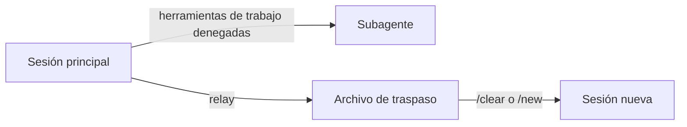

# sync_relay

[English](README.md) | [Português](README.pt-BR.md) | Español

  -lightgrey)

Mantiene la sesión principal solo en la orquestación, envía el trabajo a subagentes y pasa una sesión larga a una nueva, con un archivo de traspaso, antes de que el contexto salga caro.

## Instalación

Claude Code:

```sh
claude plugin marketplace add Sync-Labs-team/sync_relay
claude plugin install sync_relay@sync_relay
```

Codex (sin probar en una sesión real, ver [CLI compatibles](#cli-compatibles)):

```sh
codex plugin marketplace add Sync-Labs-team/sync_relay
codex plugin add sync_relay@sync_relay
```

Necesita Python 3.9 o superior como `python3`. En Claude Code el mismo plugin también añade el comando `/relay`, un botón y una línea de estado. Actualización, desinstalación y problemas frecuentes: [docs/faq.md](docs/faq.md) (en inglés).

## Puntos clave

- La sesión principal solo orquesta: lectura, búsqueda, shell, escritura, web y MCP van a un subagente, según una tabla de delegación que puedes editar. `claude -p` y `codex exec` nunca se bloquean.
- Una palabra, `relay`, guarda el estado del trabajo en un archivo, y la siguiente sesión en la misma carpeta empieza con él. El archivo incluye tu `/goal`, las tareas programadas y el trabajo en segundo plano, que `/clear` borraría o dejaría suelto.
- El punto de cambio automático sigue la ventana del modelo: 180k tokens con una ventana de 1M de Claude, 166k con 200K, 102k con un límite de 120k de Codex (primera respuesta en 30k tokens). Regla: [docs/how-it-works.md](docs/how-it-works.md).
- El hook cuesta unos 196 ms por llamada en Windows con el atajo `python3` de la Microsoft Store, y unos 26 ms de intérprete con el Python de python.org.
- 0 llamadas de red. Todo queda en tu perfil de usuario. El texto del traspaso está limitado a 9.000 caracteres.
- 90 pruebas de los hooks y del script, 182 del mod de Claude Code.

## Inicio rápido

1. Instala el plugin (arriba) y abre una sesión como siempre. La sesión principal pasa a delegar.
2. Cuando el contexto crezca, escribe la palabra `relay` sola como mensaje (en Claude Code, `/relay` también funciona). El modelo guarda el traspaso.
3. Escribe `/clear` (en Codex, `/new`). La sesión nueva empieza con el traspaso.

En Claude Code, `/relay` hace los pasos 2 y 3 por ti, y `/relay auto` los hace solo en el punto de cambio.

## Comandos

| Comando | Qué hace |
|---|---|
| `/relay` | Guarda el traspaso y abre la sesión nueva ahora (Claude Code). |
| `/relay auto` | Activa o desactiva el cambio automático. Se recuerda entre sesiones. |
| `/relay button` | Muestra u oculta el botón fijo `sync_relay auto: on/off` (solo hay en y pt-BR; en pt-BR dice `ligado/desligado`). Se recuerda entre sesiones. La línea de estado se queda. |
| `/relay status` | Modo del bloqueo, auto, contexto actual, punto de cambio y su origen, carpeta de traspasos. |
| `relay` | El mensaje completo. Igual que `/relay`, y es la forma de hacerlo en Codex (luego `/new`). |

Cualquier otro argumento muestra el uso. La línea de estado, junto a la tuya, se ve así: `sync_relay: auto off · 45k of 150k` (o `measuring`, `switching…`).

## CLI compatibles

| CLI | Estado |
|---|---|
| Claude Code 2.1.323 o superior | Probado en Windows, versiones 2.1.328 y 2.1.329. Hooks y mod. |
| Codex CLI 0.170.0 | Se instala, y el hook se ejecutó directamente, sin modelo. Sin probar en una sesión real. Solo los hooks (el mod se ignora). Aprueba los hooks en `/hooks`. |
| macOS y Linux | Sin probar. |

## Configuración

Un archivo JSON para las dos CLI: `%APPDATA%\sync_relay\config.json` en Windows, `~/.config/sync_relay/config.json` en el resto. Todas las claves son opcionales. Todas las claves, valores por defecto y variables de entorno: [docs/configuration.md](docs/configuration.md) (en inglés).

| Clave | Por defecto | Qué hace |
|---|---|---|
| `mode` | `enforce` | `enforce` bloquea las herramientas de trabajo en la sesión principal, `remind` solo recuerda, `off` no hace ninguna de las dos cosas. |
| `threshold_tokens` | `150000` | Tope del crecimiento que dispara el cambio. |
| `button` | `true` | Mostrar el botón fijo (Claude Code). |
| `auto` | `false` | Empezar con el cambio automático activado (Claude Code). |
| `lang` | `auto` | `auto`, `en` o `pt-BR`. |
| `handoff_dir` | por usuario | Dónde se guardan los archivos de traspaso. |
| `routing` | ver docs | Agente, modelo y esfuerzo por capa y por CLI. |

Para desactivarlo en una sesión, abre la CLI con `SYNC_RELAY_MODE=off`.

## Cómo funciona



1. `PreToolUse` deniega las herramientas de trabajo en la sesión principal interactiva. Los subagentes y la automatización pasan.
2. Al empezar la sesión, el plugin inyecta una tabla de delegación construida con tu configuración.
3. `relay` le pide al modelo un traspaso en Markdown, guardado en una carpeta de tu perfil de usuario.
4. En el punto de cambio, el hook `Stop` (o el mod) avisa de que toca cambiar. La siguiente sesión en la misma carpeta recibe el archivo una vez.
5. El cambio espera a los subagentes que aún no han informado.

Reglas, privacidad y mediciones: [docs/how-it-works.md](docs/how-it-works.md) (en inglés).

## Contribuir

Los informes de errores, ideas y preguntas van por [issues](https://github.com/Sync-Labs-team/sync_relay/issues/new/choose). No se aceptan pull requests de fuera. Ver [CONTRIBUTING.md](CONTRIBUTING.md).

## Seguridad

Informa de las vulnerabilidades en privado, mediante los avisos de seguridad del repositorio: [SECURITY.md](SECURITY.md).

## Licencia

MIT: [LICENSE](LICENSE). Notas de versión: [CHANGELOG.md](CHANGELOG.md).
