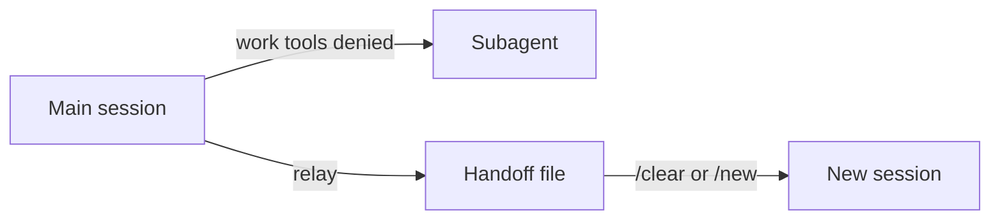

# sync_relay

English | [Português](README.pt-BR.md) | [Español](README.es.md)

  -lightgrey)

Keeps your main coding session on orchestration, sends the work to subagents, and moves a long session to a fresh one with a handoff file before the context gets expensive.

## Install

Claude Code:

```sh
claude plugin marketplace add Sync-Labs-team/sync_relay
claude plugin install sync_relay@sync_relay
```

Codex (not tested in a real session, see [Supported CLIs](#supported-clis)):

```sh
codex plugin marketplace add Sync-Labs-team/sync_relay
codex plugin add sync_relay@sync_relay
```

Needs Python 3.9 or newer as `python3`. On Claude Code the same plugin also adds the `/relay` command, a button and a status line. Upgrade, removal and common problems: [docs/faq.md](docs/faq.md).

## Highlights

- The main session only orchestrates: reads, searches, shell, writes, web and MCP calls go to a subagent from a delegation table you can edit. `claude -p` and `codex exec` are never blocked.
- One word, `relay`, writes the state of the work to a file and the next session in the same directory starts with it. The file carries your `/goal`, scheduled tasks and background work, which `/clear` would otherwise drop or leave dangling.
- The automatic switch point follows the model's window: 180k tokens on a 1M Claude window, 166k on 200K, 102k on a Codex limit of 120k (first response at 30k tokens). Rule: [docs/how-it-works.md](docs/how-it-works.md).
- Hooks cost about 196 ms per call on Windows with the Microsoft Store `python3` shortcut, and about 26 ms of interpreter time with python.org Python.
- 0 network calls. Everything stays under your user profile. Handoff text is capped at 9,000 characters.
- 90 tests for the hooks and script, 182 for the Claude Code mod.

## Quickstart

1. Install the plugin (above) and start a session as usual. The main session now delegates.
2. When the context grows, type the word `relay` alone as the message (on Claude Code, `/relay` works too). The model writes the handoff.
3. Type `/clear` (Codex: `/new`). The new session starts with the handoff.

On Claude Code, `/relay` does steps 2 and 3 for you, and `/relay auto` does them by itself at the switch point.

## Commands

| Command | What it does |
|---|---|
| `/relay` | Writes the handoff and opens the new session now (Claude Code). |
| `/relay auto` | Turns the automatic switch on or off. Remembered between sessions. |
| `/relay button` | Shows or hides the fixed button `sync_relay auto: on/off` (pt-BR: `ligado/desligado`). Remembered between sessions. The status line stays. |
| `/relay status` | Lock mode, auto, current context, switch point and where it comes from, handoff folder. |
| `relay` | The whole message. Same as `/relay`, and the way to do it on Codex (then `/new`). |

Any other argument prints the usage. The status line next to your own reads like `sync_relay: auto off · 45k of 150k` (or `measuring`, `switching…`).

## Supported CLIs

| CLI | Status |
|---|---|
| Claude Code 2.1.323 or newer | Tested on Windows, versions 2.1.328 and 2.1.329. Hooks and mod. |
| Codex CLI 0.170.0 | Installs, and the hook was run directly without a model. Not tested in a real session. Hooks only (the mod is ignored). Approve the hooks in `/hooks`. |
| macOS and Linux | Not tested. |

## Configuration

One JSON file for both CLIs: `%APPDATA%\sync_relay\config.json` on Windows, `~/.config/sync_relay/config.json` elsewhere. Every key is optional. All keys, defaults and environment variables: [docs/configuration.md](docs/configuration.md).

| Key | Default | What it does |
|---|---|---|
| `mode` | `enforce` | `enforce` blocks work tools in the main session, `remind` only reminds, `off` does neither. |
| `threshold_tokens` | `150000` | Upper bound for the growth that triggers the switch. |
| `button` | `true` | Show the fixed button (Claude Code). |
| `auto` | `false` | Start with the automatic switch on (Claude Code). |
| `lang` | `auto` | `auto`, `en` or `pt-BR`. |
| `handoff_dir` | per user | Where the handoff files go. |
| `routing` | see docs | Agent, model and effort per layer and CLI. |

To turn it off for one session, start the CLI with `SYNC_RELAY_MODE=off`.

## How it works



1. `PreToolUse` denies work tools in the main interactive session. Subagents and automation pass.
2. At session start the plugin injects a delegation table built from your config.
3. `relay` asks the model for a Markdown handoff, written to a folder in your user profile.
4. At the switch point, the `Stop` hook (or the mod) tells you to switch. The next session in the same directory gets the file once.
5. The switch waits for subagents that have not reported yet.

Rules, privacy and measurements: [docs/how-it-works.md](docs/how-it-works.md).

## Contributing

Bug reports, ideas and questions go through [issues](https://github.com/Sync-Labs-team/sync_relay/issues/new/choose). Pull requests from outside are not accepted. See [CONTRIBUTING.md](CONTRIBUTING.md).

## Security

Report vulnerabilities privately through the repository's security advisories: [SECURITY.md](SECURITY.md).

## License

MIT: [LICENSE](LICENSE). Release notes: [CHANGELOG.md](CHANGELOG.md).
