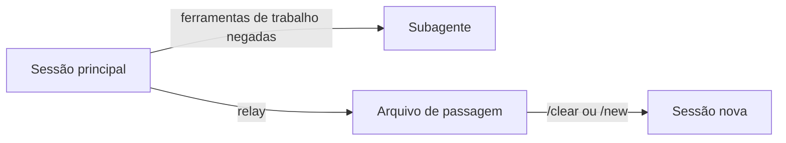

# sync_relay

[English](README.md) | Português | [Español](README.es.md)

  -lightgrey)

Mantém a sessão principal só na orquestração, manda o trabalho para subagentes e passa uma sessão longa para uma nova, com um arquivo de passagem, antes de o contexto ficar caro.

## Instalação

Claude Code:

```sh
claude plugin marketplace add sync-labs-team/plugins
claude plugin install sync-relay@sync-labs
```

Codex (não testado numa sessão real, veja [CLIs suportadas](#clis-suportadas)):

```sh
codex plugin marketplace add sync-labs-team/plugins
codex plugin add sync-relay@sync-labs
```

Precisa de Python 3.9 ou mais novo como `python3`. No Claude Code o mesmo plugin também acrescenta o comando `/relay`, um botão e uma linha de estado. Atualização, remoção e problemas comuns: [docs/faq.md](docs/faq.md) (em inglês).

## Destaques

- A sessão principal só orquestra: leitura, busca, shell, escrita, web e MCP vão para um subagente, conforme uma tabela de delegação que você pode editar. `claude -p` e `codex exec` nunca são bloqueados.
- Uma palavra, `relay`, grava o estado do trabalho num arquivo, e a próxima sessão na mesma pasta começa com ele. O arquivo leva o seu `/goal`, as tarefas agendadas e o trabalho em segundo plano, que o `/clear` apagaria ou deixaria solto.
- O ponto de troca automático segue a janela do modelo: 180k tokens numa janela de 1M do Claude, 166k em 200K, 102k num limite de 120k do Codex (primeira resposta em 30k tokens). Regra: [docs/how-it-works.md](docs/how-it-works.md).
- O gancho custa cerca de 196 ms por chamada no Windows com o atalho `python3` da Microsoft Store, e cerca de 26 ms de interpretador com o Python do python.org.
- 0 chamadas de rede. Tudo fica no seu perfil de usuário. O texto da passagem é limitado a 9.000 caracteres.
- 120 testes dos ganchos e do script, 189 do mod do Claude Code.

## Início rápido

1. Instale o plugin (acima) e abra uma sessão como de costume. A sessão principal passa a delegar.
2. Quando o contexto crescer, digite a palavra `relay` sozinha na mensagem (no Claude Code, `/relay` também funciona). O modelo grava a passagem.
3. Digite `/clear` (no Codex, `/new`). A sessão nova começa com a passagem.

No Claude Code, `/relay` faz os passos 2 e 3 por você, e `/relay auto` faz sozinho no ponto de troca.

## Comandos

| Comando | O que faz |
|---|---|
| `/relay` | Grava a passagem e abre a sessão nova agora (Claude Code). |
| `/relay auto` | Liga ou desliga a troca automática. Lembra entre sessões. |
| `/relay button` | Mostra ou esconde o botão fixo `sync_relay auto: ligado/desligado` (en: `on/off`). Lembra entre sessões. A linha de estado fica. |
| `/relay status` | Modo da trava e de onde vem (esta sessão, `SYNC_RELAY_MODE`, arquivo de configuração, padrão), auto, contexto atual, ponto de troca e a origem dele, pasta das passagens. |
| `/relay off` | Trava e lembretes desligados SÓ nesta sessão. Sem reiniciar. |
| `/relay remind` | Só o lembrete nesta sessão; nada é bloqueado. |
| `/relay on` | A trava de volta nesta sessão. |
| `relay` | A mensagem inteira. Igual a `/relay`, e é o jeito no Codex (depois `/new`). |
| `relay off`, `relay remind`, `relay on` | A mensagem inteira (maiúsculas não importam, `/` no começo vale). Igual aos três comandos acima; é o jeito sem o mod e no Codex. Vem da sua mensagem, nunca de uma chamada de ferramenta; um prompt agendado (`/loop`) não se distingue de um digitado por você. |

Qualquer outro argumento mostra o uso. A linha de estado, ao lado da sua, fica assim: `sync-relay: auto desligado · 45k de 150k` (ou `medindo`, `trocando…`).

## CLIs suportadas

| CLI | Situação |
|---|---|
| Claude Code 2.1.323 ou mais novo | Testado no Windows, versões 2.1.328 e 2.1.329. Ganchos e mod. |
| Codex CLI 0.170.0 | Instala, e o gancho foi rodado direto, sem modelo. Não testado numa sessão real. Só os ganchos (o mod é ignorado). Aprove os ganchos em `/hooks`. |
| macOS e Linux | Não testados. |

## Configuração

Um arquivo JSON para as duas CLIs: `%APPDATA%\sync_relay\config.json` no Windows, `~/.config/sync_relay/config.json` nos outros. Toda chave é opcional. Todas as chaves, padrões e variáveis de ambiente: [docs/configuration.md](docs/configuration.md) (em inglês).

| Chave | Padrão | O que faz |
|---|---|---|
| `mode` | `enforce` | `enforce` bloqueia ferramentas de trabalho na sessão principal, `remind` só lembra, `off` não faz nenhum dos dois. |
| `threshold_tokens` | `150000` | Teto do crescimento que dispara a troca. |
| `button` | `true` | Mostrar o botão fixo (Claude Code). |
| `auto` | `false` | Começar com a troca automática ligada (Claude Code). |
| `lang` | `auto` | `auto`, `en` ou `pt-BR`. |
| `handoff_dir` | por usuário | Onde ficam os arquivos de passagem. |
| `routing` | veja os docs | Agente, modelo e esforço por camada e por CLI. |
| `allow_reads` | `true` | `false` desliga a exceção de leitura abaixo. |
| `read_commands` | uma semente pequena | Padrões de comando que a sessão principal travada pode rodar. É um ponto de partida: ajuste ao seu contexto. |

Para desligar a trava numa sessão, digite `/relay off` (ou só `relay off`). Sem reiniciar.

A sessão principal também pode rodar alguns comandos inofensivos (`git status`, `ls`, `cat` de arquivo pequeno...) e fazer `Read` de arquivo pequeno. Essa lista é só uma semente em `read_commands`: troque, acrescente ou esvazie com `[]`. Um repositório pode somar a dele com `.claude/sync_relay.json`. A única regra fixa: o comando inteiro tem de ser UM comando simples, sem `|`, `;`, `&`, redirecionamento, crase, `$`, quebra de linha, aspas, barra invertida nem curinga, e a primeira palavra de um padrão é literal. `cat`, `head` e `tail` só leem arquivo regular existente dentro do limite de tamanho. Detalhes: [docs/configuration.md](docs/configuration.md) (em inglês).

## Como funciona



1. O `PreToolUse` nega ferramentas de trabalho na sessão principal interativa. Subagentes e automação passam.
2. No início da sessão, o plugin injeta uma tabela de delegação montada a partir da sua configuração.
3. `relay` pede ao modelo uma passagem em Markdown, gravada numa pasta do seu perfil de usuário.
4. No ponto de troca, o gancho `Stop` (ou o mod) avisa que é hora de trocar. A próxima sessão na mesma pasta recebe o arquivo uma vez.
5. A troca espera os subagentes que ainda não reportaram.

Regras, privacidade e medições: [docs/how-it-works.md](docs/how-it-works.md) (em inglês).

## Contribuição

Relatos de bug, ideias e perguntas entram por [issues](https://github.com/Sync-Labs-team/sync_relay/issues/new/choose). Pull requests de fora não são aceitos. Veja [CONTRIBUTING.md](CONTRIBUTING.md).

## Segurança

Relate vulnerabilidades em particular, pelos avisos de segurança do repositório: [SECURITY.md](SECURITY.md).

## Licença

MIT: [LICENSE](LICENSE). Notas de versão: [CHANGELOG.md](CHANGELOG.md).
